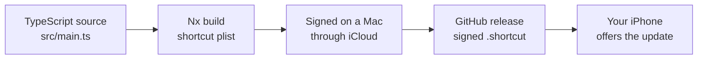

  <h1>iOS Shortcuts 📱 - AI Shortcuts for iPhone and iPad</h1>
  
<strong>Shortcuts written in TypeScript, shipped as signed releases, and kept up to date on your device</strong>

  

    
    
    
    
    
  

## Shortcuts

<!-- TABLE_START -->

| Shortcut                                                       | Description                                                                  | Latest Release                                                                                | Download Link                                                                                                                         | Downloads                                                                                                                                                                                                              |
| -------------------------------------------------------------- | ---------------------------------------------------------------------------- | --------------------------------------------------------------------------------------------- | ------------------------------------------------------------------------------------------------------------------------------------- | ---------------------------------------------------------------------------------------------------------------------------------------------------------------------------------------------------------------------- |
| [AI Response](./projects/packages/ai-response/README.md)       | Get AI suggestions for your current chat (support any chat app)              | [v0.2.6](https://github.com/Avivbens/ios-shortcuts/releases/tag/release/ai-response/0.2.6)    | [Download Shortcut](https://github.com/Avivbens/ios-shortcuts/releases/download/release/ai-response/0.2.6/AI.Response.shortcut)       |     |
| [Translate Text](./projects/packages/translate-text/README.md) | Translate text from the Share Sheet, clipboard, or free-style input using AI | [v0.2.7](https://github.com/Avivbens/ios-shortcuts/releases/tag/release/translate-text/0.2.7) | [Download Shortcut](https://github.com/Avivbens/ios-shortcuts/releases/download/release/translate-text/0.2.7/Translate.Text.shortcut) |  |

<!-- TABLE_END -->

### 

## 📥 Installation

1. Tap the **Download Shortcut** link for the shortcut you want in the table above.
2. Open the file in the **Shortcuts** app, review its actions, and tap **Add Shortcut**.
3. Run it from the Share Sheet, Siri, your Home Screen or the Action Button.

**Note:** AI-powered shortcuts (AI Response, Translate Text) ask which AI model to use when you add them: Apple Intelligence **Cloud** (the default) or **On-Device** on a device that supports it, or **ChatGPT**, which needs the ChatGPT app installed and signed in.

## 🚀 Overview

iOS Shortcuts is a collection of shortcuts managed like software: every shortcut is TypeScript source, built and checked in CI, signed, and attached to a GitHub release.

**What Does iOS Shortcuts Offer?**

- 🔄 **Updates on your device:** installed shortcuts check for new releases on their own and offer the newer download.
- 📦 **Versioned releases:** every change ships as a tagged release with a signed `.shortcut` and release notes.
- 🛠️ **Shortcuts as code:** each shortcut is built from `src/main.ts` on a small typed API, reviewed in pull requests instead of edited by hand.

## 🤝 Contributing

We welcome contributions! New shortcuts start from a generator, `nx g @ios-shortcuts/workspace:generate-shortcut <name>`. Please check out our [Contributing Guide](CONTRIBUTING.md) for writing, porting and releasing a shortcut.

## 📜 License

This project is licensed under the MIT License. See the [LICENSE](LICENSE) file for further details.

## 🙏 Acknowledgments

- Kudos to [Nx](https://nx.dev) for their powerful monorepo capabilities.
- A huge thank you to all our [contributors](https://github.com/Avivbens/ios-shortcuts/graphs/contributors) who help make iOS Shortcuts better every day.

---

  Built with ❤️ by <a href="https://github.com/Avivbens">Aviv Ben Shahar</a> · <a href="https://www.linkedin.com/in/aviv-ben-shahar-33583b211/">LinkedIn</a>

